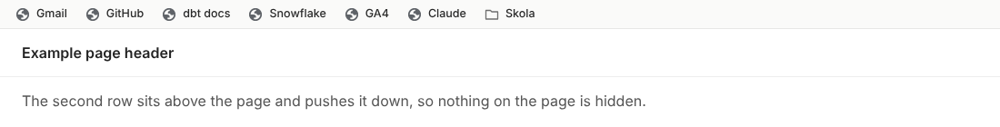
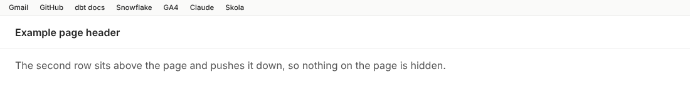
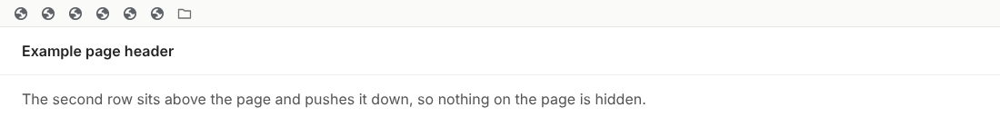
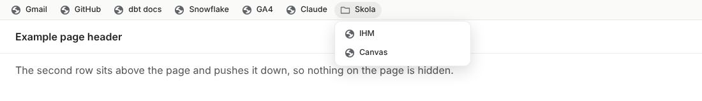
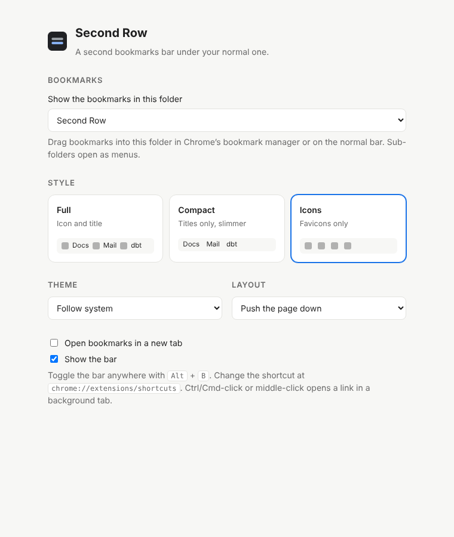

# Second Row

A second bookmarks bar for Google Chrome. It sits at the top of every page, right under Chrome's normal bookmarks bar, and shows the bookmarks from one folder you choose.



## Why an extension and not Stylus?

The first idea was to inject a second row with Stylus. That doesn't work: Stylus can only add **CSS** to web pages. It can't create new HTML elements, read your bookmarks, or touch Chrome's own toolbar. So Second Row is a small Manifest V3 extension instead:

- it reads a bookmarks folder through the `chrome.bookmarks` API,
- draws the bar inside a **closed Shadow DOM**, so a page's CSS can't break the bar and the bar's CSS can't leak into the page,
- and stays in sync live when you add, move or rename bookmarks.

## Features

- **Three styles**: Full (icon and title), Compact (titles only, slimmer) and Icons (favicons only, title on hover).
- **Sub-folders open as menus.**
- **Light, dark or follow-system theme.**
- **Push or overlay layout**: push the page down so nothing is hidden, or float over it.
- **Alt + B** toggles the bar on any page (change it at `chrome://extensions/shortcuts`).
- **Ctrl/Cmd-click or middle-click** opens a link in a background tab. Optionally open every link in a new tab.
- Settings sync between your Chrome installations through `chrome.storage.sync`.

| Compact | Icons |
| --- | --- |
|  |  |



## Install

1. Download or clone this repo.
2. Open `chrome://extensions` and turn on **Developer mode**.
3. Click **Load unpacked** and pick the `src` folder.
4. The settings page opens. A folder called **Second Row** has been created under *Other bookmarks*. Drag bookmarks into it, or choose any other folder.



## Limits

- Chrome doesn't let extensions run on its own pages (`chrome://`, the Web Store, the new tab page), so the bar isn't shown there.
- In push mode the page gets a top margin. A few sites with their own fixed headers may need overlay mode.

## Privacy

Second Row has no server and makes no network requests. It reads only the folder you pick, and favicons come from Chrome's own local favicon cache (`favicon` permission). Settings are stored in Chrome sync storage.

## Structure

```
src/
  manifest.json   MV3 manifest: bookmarks, storage, favicon permissions
  background.js   service worker: reads the folder, opens links, Alt+B
  content.js      draws the bar in a closed Shadow DOM
  bar.css         the three styles and both themes
  options.*       settings page
test.js           Playwright test that loads the extension and takes the screenshots
```

To run the test: `npm i playwright`, serve any local page on port 8765, then `xvfb-run node test.js` (extensions need a headed browser).

## License

MIT
